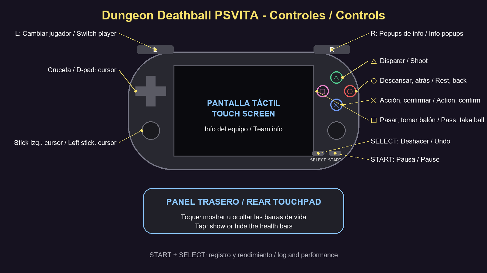

# Dungeon Deathball PSVITA

[Español](#español) · [English](#english)



---

## Español

Port nativo de **Dungeon Deathball** para PlayStation Vita, escrito en C++17 desde cero (no es un emulador ni un wrapper de Unity). Todas las pantallas se reconstruyen a partir de los datos de interfaz del juego original, que se extraen de **tu propia copia de Steam** directamente en la consola.

**Versión 1.0** · Title ID `DDBV00001`

### ⚠️ Aviso legal

- **Este proyecto NO apoya ni tolera la piratería.** Necesitas una **copia legal de Dungeon Deathball comprada en Steam**.
- El repositorio y el VPK **no incluyen el juego**: ni código, ni música, ni sprites, ni textos. El VPK solo trae el motor del port. En el primer arranque, la consola genera los datos a partir de los archivos de tu copia de Steam.
- El port se probó con la **build de Steam 20267473** (versión del juego **1.4.5**, App ID 861330). Con otras builds puede funcionar, pero no está probado.
- Dungeon Deathball es propiedad de sus autores (Matt Glanville). Este es un proyecto de fans sin ánimo de lucro y sin relación con ellos ni con Sony.

### Requisitos

**En la consola**
- PS Vita o PS TV con **HENkaku / h-encore / Enso** (firmware modificado) y **VitaShell**.
- **`ur0:data/libshacccg.suprx`**: el compilador de shaders que necesita vitaGL. Se extrae con **ShaRKBR33D** (o SharkF00D) en la propia consola. Es el mismo requisito que el de otros homebrew que usan vitaGL.
- No hace falta **ningún plugin de taiHEN**.
- Unos **300 MB libres** en `ux0:`: unos 155 MB de la copia del juego más unos 105 MB de datos generados.

**De tu copia de Steam** (carpeta `Steam/steamapps/common/Dungeon Deathball/`)
- La carpeta **`Dungeon Deathball_Data/`** completa.
- El archivo **`UnityPlayer.dll`** (de él se leen las cabeceras de audio).

### Instalación

1. Descarga `ddvita.vpk` desde la página de [Releases](../../releases) e instálalo con **VitaShell**.
2. En la Vita, crea la carpeta `ux0:data/ddvita/game/`.
3. Copia en ella, por FTP o USB desde VitaShell, la carpeta `Dungeon Deathball_Data/` y el archivo `UnityPlayer.dll`. Debe quedar así:
   ```
   ux0:data/ddvita/game/Dungeon Deathball_Data/...
   ux0:data/ddvita/game/UnityPlayer.dll
   ```
4. Comprueba que existe `ur0:data/libshacccg.suprx`. Si no, abre ShaRKBR33D una vez.
5. Abre **Dungeon Deathball PSVITA** desde el LiveArea. En el primer arranque verás una pantalla de carga mientras se instalan los datos, una sola vez (unos minutos). Las actualizaciones del port solo vuelven a generar lo que cambió.
6. Cuando termine, puedes borrar `ux0:data/ddvita/game/` para liberar espacio. Se necesitará de nuevo si una versión futura del port exporta más datos.

Las partidas y el progreso se guardan en `ux0:data/ddvita/` (`meta.json`, `save.json`, `settings.json`).

### Controles

| Botón | En juego | En menús |
|---|---|---|
| Cruceta / stick izquierdo | Mover el cursor | Navegar |
| ✕ | Acción en la casilla | Confirmar |
| ○ | Descansar | Atrás |
| □ | Pasar / tomar el balón | — |
| △ | Disparar | — |
| L | Cambiar de jugador | — |
| R | Mostrar u ocultar los popups de info | — |
| SELECT | Deshacer | — |
| START | Pausa | — |
| **Pantalla táctil** | Info del equipo (stats, ataques, rasgos, balón) | — |
| **Panel trasero** | Mostrar u ocultar las barras de vida | — |
| START + SELECT | Registro y rendimiento (depuración) | — |

### Qué incluye

- El juego completo: los modos Normal, Daily Challenge, Judgment y Action, los 4 trials, 12 stages, todos los equipos, perks, clases, mejoras y fichajes, los ball mods, las llaves de calavera, los 84 logros (locales), el Hall of Fame y las estadísticas.
- Eventos de temporada (Halloween y Pascua) según la fecha de la consola.
- **Interfaz reconstruida desde los datos del original**:
  - menús, HUD, resultados, gestión del equipo y resultados finales;
  - How to Play, opciones, popups de enemigo, casilla y coste;
  - transiciones entre escenas y subtítulos de la intro.
- Todas las opciones de Gameplay y Gráficos: Fast Mode, cámara dinámica, sangre gris, popups, Pixel Filter y fuentes suaves.
- 3D a la resolución nativa de la Vita (960×540). Con **Pixel Filter** se recupera el aspecto original a 640×360.
- Música, jingles, voces, efectos y el público.
- Extras de la Vita: las barras de vida con el orden de acción (panel trasero), la info del equipo (pantalla táctil), el LiveArea y una pantalla de carga.

### Steam vs. PS Vita

| | Steam (PC) | PS Vita (este port) |
|---|---|---|
| Motor | Unity 2020.3 | C++17 propio con vitaGL |
| Resolución | La de la ventana, con filtro 640×360 | 960×540 nativo o 640×360 con Pixel Filter |
| Control | Ratón, teclado y mando | Botones, pantalla táctil y panel trasero |
| Info en pantalla | Popups al pasar el ratón | Popups bajo el cursor (R), barras de vida y info del equipo táctiles |
| Logros | Steam | Locales, en la pantalla Stats & Achievements |
| Clasificaciones | Steam Leaderboards | No |
| Idioma | Inglés (el original lo fuerza) | Inglés |
| Datos | Incluidos | Se generan desde tu copia de Steam |

### Limitaciones conocidas

- **Cámaras:** los ajustes de las cámaras de Cinemachine del original no se pueden extraer. Las cámaras dinámicas y el paneo inicial son aproximaciones.
- **Animaciones:** las de los enemigos, las partículas y los marcadores de casilla no se han cotejado una a una con el original.
- **Daily Challenge:** se genera con el mismo algoritmo y la misma semilla por fecha, pero no se ha comparado con el reto de Steam del mismo día.
- **How to Play:** faltan las imágenes de los jugadores generados aleatoriamente.
- **Sin equivalente en la Vita:** el aviso de logro es propio del port (el original usa el de Steam); no hay Steam Leaderboards ni página de reasignar teclas.
- **Trofeos:** el homebrew no puede dar trofeos de PlayStation, así que los logros son locales.

### Cómo se hizo: 100 % vibecode con Claude

Este port se hizo **enteramente con "vibe coding" junto a Claude** (Anthropic) en Claude Code. El usuario dirigía, probaba en la Vita y daba feedback. Claude escribió el código, las herramientas y la documentación. El proceso:

1. **Análisis del original:** se estudió el código C# descompilado de la copia de Steam del usuario, solo como referencia local (no se publica). Así se entendieron las reglas, la IA, la puntuación y cada pantalla.
2. **Núcleo determinista:** la simulación (RNG de Mono, generador de sesiones, turnos, IA, combate y balón) se tradujo a C++ clase por clase. Se comprobó contra el original con cientos de partidas y semillas idénticas.
3. **Render y audio:** un renderer OpenGL de función fija compatible con vitaGL, un mezclador de audio propio (IMA ADPCM) y la reproducción de los eventos de la simulación con sus tiempos.
4. **Instalador en la consola:** un lector propio de los archivos de Unity (SerializedFile, UnityFS con LZ4, texturas, Vorbis en FSB5 y fuentes TTF). Genera los datos en la Vita, sin PC ni Python, a partir de la copia del usuario.
5. **Interfaz desde los datos originales:** el instalador exporta los árboles de Canvas de las escenas y prefabs del juego (RectTransform, layouts, sprites, textos y tintes). Un motor de Canvas propio los reproduce, y cada pantalla se rellena como lo hacían sus scripts.
6. **Bucle de verificación:** cada cambio se compilaba para PC (SDL2 sin ventana) y se capturaba en pantalla a 960×544 para compararlo. Después se compilaba el VPK y el usuario lo probaba en su Vita.
7. **Depuración en hardware:** los fallos de la consola se resolvieron analizando los core dumps (`.psp2dmp`) de la Vita. Por ejemplo, una corrupción de memoria entre el hilo de audio y el de juego en el Daily Challenge.

### Compilar desde el código

Consulta [port/README.md](port/README.md). Hace falta VitaSDK con vitaGL, vitashark, SceShaccCgExt y math-neon. `cmake` y `make` generan `ddvita.vpk`. Las imágenes del LiveArea basadas en el arte de Steam se generan en local con `port/tools/make_livearea_steam.py` desde tu propia instalación de Steam, y no se suben al repositorio.

---

## English

A native **Dungeon Deathball** port for the PlayStation Vita, written from scratch in C++17 (not an emulator or a Unity wrapper). Every screen is rebuilt from the original game's UI data, which is extracted from **your own Steam copy** on the console itself.

**Version 1.0** · Title ID `DDBV00001`

### ⚠️ Disclaimer

- **This project does NOT condone or support piracy.** You need a **legal copy of Dungeon Deathball bought on Steam**.
- Neither the repository nor the VPK **includes the game**: no code, music, sprites or text. The VPK only contains the port's engine. On first launch, the console builds the data from the files of your own Steam copy.
- The port was tested with **Steam build 20267473** (game version **1.4.5**, App ID 861330). Other builds may work but are untested.
- Dungeon Deathball belongs to its authors (Matt Glanville). This is a non-profit fan project with no affiliation to them or to Sony.

### Requirements

**On the console**
- A PS Vita or PS TV with **HENkaku / h-encore / Enso** (custom firmware) and **VitaShell**.
- **`ur0:data/libshacccg.suprx`**: the shader compiler vitaGL needs. Extract it with **ShaRKBR33D** (or SharkF00D) on the console. Other vitaGL homebrew has the same requirement.
- **No taiHEN plugins** are needed.
- About **300 MB free** on `ux0:`: roughly 155 MB for the game copy plus 105 MB of generated data.

**From your Steam copy** (folder `Steam/steamapps/common/Dungeon Deathball/`)
- The whole **`Dungeon Deathball_Data/`** folder.
- The **`UnityPlayer.dll`** file (its audio headers are read).

### Installation

1. Download `ddvita.vpk` from the [Releases](../../releases) page and install it with **VitaShell**.
2. On the Vita, create the folder `ux0:data/ddvita/game/`.
3. Copy the `Dungeon Deathball_Data/` folder and `UnityPlayer.dll` into it, over FTP or USB from VitaShell. It should look like this:
   ```
   ux0:data/ddvita/game/Dungeon Deathball_Data/...
   ux0:data/ddvita/game/UnityPlayer.dll
   ```
4. Check that `ur0:data/libshacccg.suprx` exists. If it doesn't, run ShaRKBR33D once.
5. Launch **Dungeon Deathball PSVITA** from the LiveArea. On first launch a loading screen shows while the data is installed, only once (a few minutes). Port updates only rebuild what changed.
6. When it's done you can delete `ux0:data/ddvita/game/` to free space. A future version of the port that exports more data will need it again.

Saves and progress are stored in `ux0:data/ddvita/` (`meta.json`, `save.json`, `settings.json`).

### Controls

| Button | In game | In menus |
|---|---|---|
| D-pad / left stick | Move the cursor | Navigate |
| ✕ | Action on the tile | Confirm |
| ○ | Rest | Back |
| □ | Pass / take the ball | — |
| △ | Shoot | — |
| L | Switch player | — |
| R | Show or hide the info popups | — |
| SELECT | Undo | — |
| START | Pause | — |
| **Touch screen** | Team info (stats, attacks, traits, ball) | — |
| **Rear touchpad** | Show or hide the health bars | — |
| START + SELECT | Log and performance readout (debug) | — |

### What's included

- The full game: Normal, Daily Challenge, Judgment and Action modes, the 4 trials, 12 stages, every team, perk, class, upgrade and recruit, the ball mods, skull keys, the 84 achievements (local), the Hall of Fame and stats.
- Seasonal events (Halloween and Easter) by the console's date.
- **UI rebuilt from the original's data**:
  - menus, HUD, results, team management and final results;
  - How to Play, options, enemy, tile and cost popups;
  - scene transitions and intro subtitles.
- Every Gameplay and Graphics option: Fast Mode, dynamic camera, grey blood, popups, Pixel Filter and smooth fonts.
- 3D at the Vita's native resolution (960×540). **Pixel Filter** brings back the original 640×360 look.
- Music, jingles, voices, sound effects and the crowd.
- Vita extras: health bars with act order (rear touchpad), team info (touch screen), the LiveArea and a loading screen.

### Steam vs. PS Vita

| | Steam (PC) | PS Vita (this port) |
|---|---|---|
| Engine | Unity 2020.3 | Custom C++17 with vitaGL |
| Resolution | Window size, with a 640×360 filter | Native 960×540, or 640×360 with Pixel Filter |
| Input | Mouse, keyboard and gamepad | Buttons, touch screen and rear touchpad |
| On-screen info | Mouse-over popups | Popups under the cursor (R), touch health bars and team info |
| Achievements | Steam | Local, on the Stats & Achievements screen |
| Leaderboards | Steam Leaderboards | No |
| Language | English (the original forces it) | English |
| Data | Included | Built from your own Steam copy |

### Known limitations

- **Cameras:** the original's Cinemachine camera settings can't be extracted, so the dynamic cameras and the intro pan are approximations.
- **Animations:** enemy animations, particles and tile markers haven't been compared one by one with the original.
- **Daily Challenge:** it uses the same algorithm and the same date-based seed, but hasn't been compared with Steam's challenge for the same day.
- **How to Play:** the pictures of randomly generated players are missing.
- **No Vita equivalent:** the achievement notice is the port's own (the original uses Steam's), and there are no Steam Leaderboards or key-remapping page.
- **Trophies:** homebrew can't award PlayStation trophies, so achievements are local.

### How it was made: 100% vibe-coded with Claude

This port was made **entirely by "vibe coding" with Claude** (Anthropic) in Claude Code. The user steered, tested on the Vita and gave feedback. Claude wrote the code, the tools and the documentation. The process:

1. **Studying the original:** the decompiled C# of the user's Steam copy was used only as a local reference (it is not published). It showed how the rules, AI, scoring and every screen work.
2. **Deterministic core:** the simulation (Mono's RNG, the session generator, turns, AI, combat and ball) was translated to C++ class by class. It was checked against the original with hundreds of games on identical seeds.
3. **Rendering and audio:** a fixed-function OpenGL renderer compatible with vitaGL, a custom audio mixer (IMA ADPCM), and timed playback of the simulation's events.
4. **On-console installer:** a custom reader for Unity's files (SerializedFile, UnityFS with LZ4, textures, Vorbis in FSB5 and TTF fonts). It builds the data on the Vita from the user's copy, with no PC or Python.
5. **UI from the original data:** the installer exports the Canvas trees of the game's scenes and prefabs (RectTransform, layouts, sprites, texts and tints). A custom Canvas engine reproduces them, and each screen is filled in the way its scripts did.
6. **Verification loop:** every change was built for PC (headless SDL2) and captured at 960×544 for comparison. Then the VPK was built and the user tested it on their Vita.
7. **Debugging on hardware:** console bugs were fixed by analysing the Vita's core dumps (`.psp2dmp`). One example is a memory corruption between the audio and game threads in the Daily Challenge.

### Building from source

See [port/README.md](port/README.md). It needs VitaSDK with vitaGL, vitashark, SceShaccCgExt and math-neon. `cmake` and `make` produce `ddvita.vpk`. The LiveArea images based on the Steam art are generated locally from your own Steam install with `port/tools/make_livearea_steam.py`, and are not committed.
